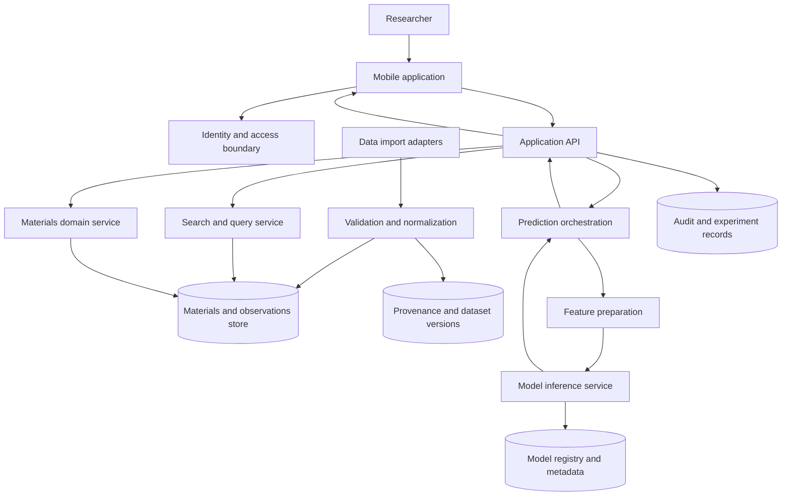
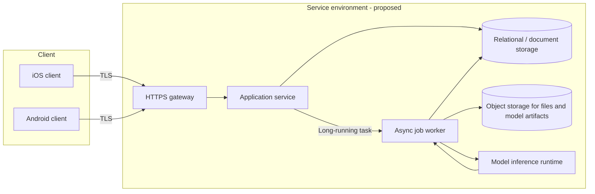
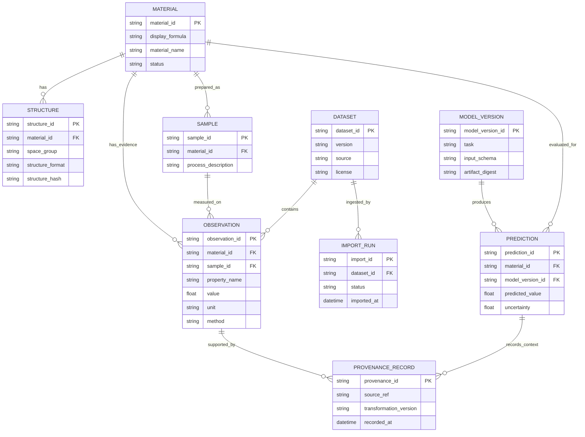
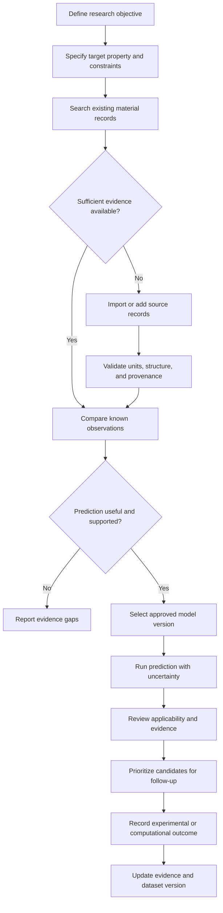
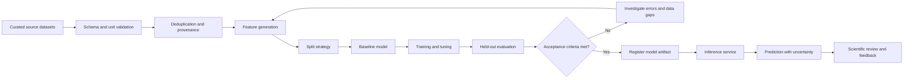
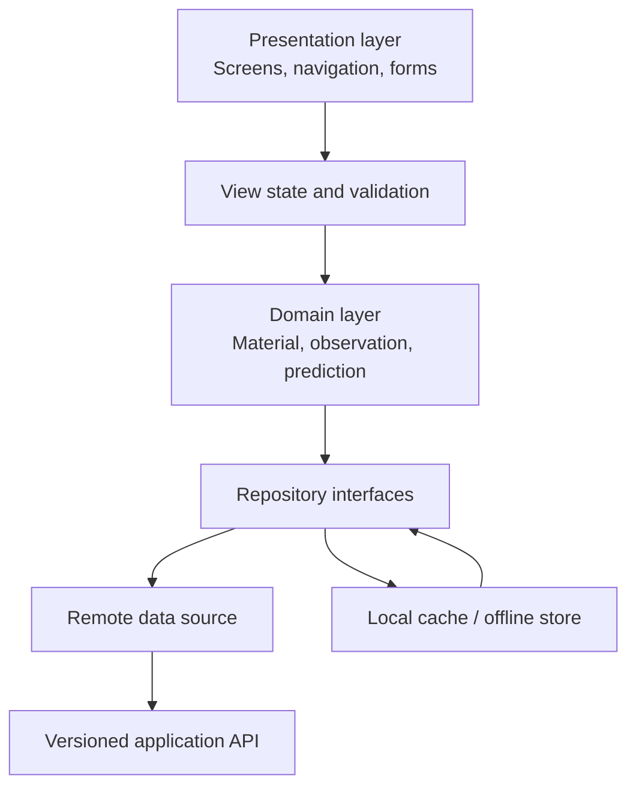
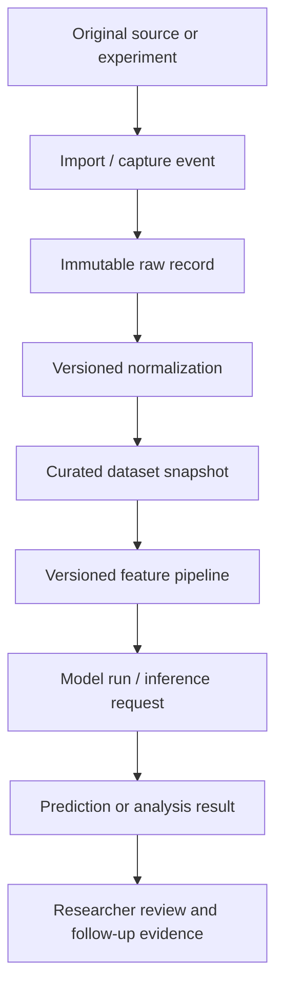

# Lattice AI for Materials Science

> **An AI-assisted workspace concept for organizing materials knowledge, exploring candidate materials, and making computational materials research more reproducible.**

[](LICENSE)


 
---

## Table of contents

1. [Project overview](#1-project-overview)
2. [Scientific problem and design goals](#2-scientific-problem-and-design-goals)
3. [Conceptual system architecture](#3-conceptual-system-architecture)
4. [Materials data model](#4-materials-data-model)
5. [Researcher workflows](#5-researcher-workflows)
6. [AI and machine-learning lifecycle](#6-ai-and-machine-learning-lifecycle)
7. [Mobile application architecture](#7-mobile-application-architecture)
8. [Proposed API and integration boundaries](#8-proposed-api-and-integration-boundaries)
9. [Scientific validation and evaluation](#9-scientific-validation-and-evaluation)
10. [Data quality, provenance, and reproducibility](#10-data-quality-provenance-and-reproducibility)
11. [Security, privacy, and responsible use](#11-security-privacy-and-responsible-use)
12. [Development setup and repository orientation](#12-development-setup-and-repository-orientation)
13. [Testing strategy](#13-testing-strategy)
14. [Roadmap and contribution guidelines](#14-roadmap-and-contribution-guidelines)
15. [Glossary and references](#15-glossary-and-references)

---

## 1. Project overview

Lattice AI for Materials Science is a project positioned around the intersection of mobile software, materials information, and AI-assisted research. The intended product direction described in this document is a researcher-facing environment in which a user can describe a material or target property, organize relevant evidence, inspect candidate materials, and compare predictions with experimental or computational results.

Materials research is inherently multi-scale. A useful representation may need to connect chemical composition, crystal structure, processing history, microstructure, measurement conditions, and observed properties. AI can help organize and analyze this information, but only when the underlying records are traceable and the uncertainty and applicability of a prediction are visible.

### 1.1 Intended users

The proposed audience includes:

- **Materials researchers** exploring composition–structure–property relationships.
- **Computational scientists** comparing calculated properties and model-generated candidates.
- **Experimental teams** organizing measurements and identifying follow-up experiments.
- **Students and educators** learning how structured materials data and predictive models fit into a research workflow.
- **Research software developers** integrating datasets, simulation tools, and model services.

These are intended user groups, not verified user accounts or deployed product roles.

### 1.2 Product principles

1. **Evidence before prediction.** Preserve the source and context of every material record and measurement.
2. **Uncertainty is part of the result.** Predictions should communicate confidence, applicability limits, and missing inputs.
3. **Reproducibility by default.** Record dataset versions, feature definitions, model versions, and relevant execution metadata.
4. **Human scientific review.** AI suggestions are hypotheses or prioritization aids, not experimental confirmation.
5. **Interoperability.** Prefer explicit, documented data contracts over tightly coupled UI and model code.
6. **Mobile-first access, not mobile-only science.** A phone interface can support discovery and review while larger-scale training and simulation remain server- or workstation-side activities.

### 1.3 Scope and non-goals

The reference design focuses on literature/data organization, candidate exploration, property prediction, and research traceability. It does not imply that the project performs quantum-mechanical calculations, controls laboratory instruments, certifies materials for industrial use, or replaces peer-reviewed validation. Such capabilities would require separately specified integrations, validation, and safety controls.

---

## 2. Scientific problem and design goals

### 2.1 The materials information chain

A measured property is rarely meaningful without its context. For example, two records that share a nominal chemical formula may differ in polymorph, defect concentration, synthesis route, heat treatment, porosity, grain size, or measurement temperature. A reliable platform should therefore avoid collapsing a material into a formula string alone.

A useful research record links at least five concepts:

| Concept | Example fields | Why it matters |
|---|---|---|
| Composition | Element symbols, fractions, formula, dopants | Defines the nominal chemical system |
| Structure | Space group, lattice parameters, atomic sites, phase | Distinguishes structural arrangements |
| Processing | Synthesis route, temperature, pressure, duration, atmosphere | Captures preparation-dependent variation |
| Measurement or calculation | Property, value, unit, method, conditions | Gives the result scientific context |
| Provenance | Source, DOI or dataset ID, author, timestamp, version | Makes the record traceable |

### 2.2 Design goals

The proposed product should make it straightforward to:

- search or filter material records using chemistry, structure, property, and source metadata;
- inspect a material's associated measurements and computational results;
- compare candidates against a defined target property or constraint set;
- request a model prediction only when the required input fields are available;
- distinguish measured values, simulation results, and model estimates in the interface;
- export a reproducible record of the data and model context behind a result.

### 2.3 Key terminology

- **Material:** A composition/structure/process entity under study.
- **Observation:** A measured or calculated value associated with a material and a method.
- **Candidate:** A material record being assessed against a research objective.
- **Prediction:** A model output, including its model identity and uncertainty information.
- **Provenance:** Metadata describing where a record came from and how it was transformed.
- **Applicability domain:** The region of input space for which a model has supporting validation evidence.

---

## 3. Conceptual system architecture

> **Status: proposed architecture.** The repository's current published file listing does not establish that these services or layers are implemented.

A maintainable design separates the mobile user experience from scientific data handling and model execution. The mobile client should use stable service contracts and should not embed large training datasets or assume that a model can run locally.

### 3.1 Logical component diagram



### 3.2 Component responsibilities

| Component | Responsibility | Design boundary |
|---|---|---|
| Mobile application | Search, inspect records, submit requests, review results | Presentation and interaction; no hidden scientific transformations |
| Application API | Validate requests, authorize access, coordinate domain operations | Versioned external contract |
| Materials domain service | Material identity, structure, observations, candidate metadata | Scientific entities and invariants |
| Import adapters | Translate supported source formats into an internal schema | Source-specific parsing is isolated here |
| Validation/normalization | Units, required fields, ranges, duplicate checks, schema validation | Reject or quarantine invalid records with reasons |
| Search service | Filter and retrieve records | Search ranking must not be confused with scientific validity |
| Feature preparation | Transform validated inputs into model features | Versioned transformations and feature provenance |
| Inference service | Run a registered model and return outputs | Model version, schema, uncertainty, and applicability metadata |
| Model registry | Store model identity, artifacts, metrics, and compatibility | Immutable release identifiers are preferred |
| Audit/provenance store | Record imports, transformations, and prediction context | Enables reproducibility and review |

### 3.3 Trust boundaries and data flow

The mobile client should be treated as an untrusted environment. Authorization and input validation belong on the service side, even when the interface performs preliminary checks for usability. Imported scientific data should also be treated as untrusted until schema, units, provenance, and consistency checks pass.

A prediction request should not directly trigger arbitrary model loading from a user-supplied path. Instead, the server should resolve a named, approved model version through a controlled registry and verify that the input schema is compatible.

### 3.4 Suggested deployment topology



This topology is a deployment option, not a description of the current hosting environment. The appropriate database, cloud provider, queue, and inference runtime should be selected after inspecting actual usage, data volume, and operational requirements.

---

## 4. Materials data model

The central data-design requirement is to represent a material and its evidence without losing context. A formula can be a useful search key, but it is not a sufficient global identifier for every polymorph, processing condition, or sample.

### 4.1 Proposed entity relationship model



The entity names and relations above are proposed. They should be mapped to the actual project structures and storage layer once the source package is inspected.

### 4.2 Recommended material record fields

| Field | Type | Example / notes |
|---|---|---|
| `material_id` | Stable string identifier | Internal identifier; do not rely on formula as a unique key |
| `formula` | String | Preserve a canonical representation and, where needed, the submitted form |
| `composition` | Structured list | Element, fraction, and fraction basis (atomic, mass, or other) |
| `structure` | Object or linked record | Space group, lattice parameters, sites, occupancy, and source format |
| `processing` | Structured object | Synthesis and post-processing conditions, with units |
| `sample_id` | Stable string | Separates nominal material from a physical specimen |
| `source` | Structured provenance | DOI, repository ID, publication, or contributor reference |
| `created_at` | Timestamp | Use a documented timezone convention, preferably UTC in storage |
| `schema_version` | String | Enables controlled schema evolution |

### 4.3 Recommended observation fields

Every observation should include the measured or calculated property, numeric value, unit, method, conditions, uncertainty when available, sample/material link, source reference, and data-quality status. Units must be explicit. A value such as `300` without a unit is not a complete scientific datum.

Store the original source value when normalization is required. For example, if an imported value is converted from one unit to another, retain both the original value/unit and the normalized value/unit alongside the conversion rule/version.

### 4.4 Data validation rules

A proposed ingestion validator should check:

1. Required identifiers and schema version are present.
2. Chemical composition is parseable and fractions follow the declared basis.
3. Physical quantities have recognized units and valid conversions.
4. Structure data can be parsed by the declared structure format, where applicable.
5. Values are finite and pass property-specific plausibility checks, without silently deleting unusual scientific results.
6. Sample, material, dataset, and source references resolve consistently.
7. Duplicate detection considers composition, structure, conditions, and source rather than formula alone.

Records that fail validation should be rejected or quarantined with actionable messages. Silent data repair is discouraged; transformations should be explicit and recorded.

---

## 5. Researcher workflows

The proposed workflow starts with a research question and ends with a result that can be inspected, challenged, exported, and updated when new evidence becomes available.

### 5.1 Candidate exploration workflow



### 5.2 Candidate comparison

A comparison view should make it possible to distinguish:

- measured and computed values from model estimates;
- observations from different sources or protocols;
- nominal composition from specimen-specific preparation;
- predicted ranking from validated performance;
- missing data from a true zero value.

Ranking criteria should be explicit and reviewable. A weighted score can be useful for triage, but the interface should expose the underlying property values, weights, constraints, and uncertainty rather than presenting a single unexplained number.

### 5.3 Prediction result lifecycle

A prediction should carry enough context to reproduce or audit the request:

- input material and sample identifiers;
- input values and schema version;
- model name and immutable model version;
- feature pipeline version;
- output property, value, and unit;
- uncertainty representation and applicability warning;
- inference timestamp and execution identifier.

A prediction is not an observation. When experimental validation later becomes available, it should be stored as a separate observation linked to the relevant candidate and prediction.

---

## 6. AI and machine-learning lifecycle

> **No trained model, benchmark, or model provider is confirmed by the currently inspectable repository listing.** This section describes a recommended lifecycle for any future model integration.

### 6.1 End-to-end model pipeline



### 6.2 Dataset preparation

Before model training, document the target property, target units, source datasets, exclusions, duplicate policy, missing-value policy, and any transformations. Preserve a versioned snapshot or a reproducible manifest of the records used for each experiment.

Splitting strategy is particularly important in materials science. A random row-level split can overestimate generalization when nearly identical compositions, structures, or records from the same source appear in both training and test partitions. Depending on the scientific objective, consider grouping by composition family, structure prototype, source publication, material identity, or time. The split must reflect the intended deployment question.

### 6.3 Feature engineering

Features may be derived from chemistry, structure, processing, or computed descriptors. Each feature should have a documented definition, units, missing-data behavior, and version. Feature transformations must be fit on training data only where fitting is required; information from validation/test partitions must not leak into training.

The platform should avoid treating a feature vector as self-explanatory. A saved prediction should reference the feature pipeline version and enough metadata to reconstruct its inputs.

### 6.4 Model evaluation

Select metrics according to the task:

| Task | Candidate metrics | Important caveat |
|---|---|---|
| Regression | MAE, RMSE, median absolute error, calibration diagnostics | Report target units and error distribution |
| Classification | Precision, recall, F1, ROC-AUC, PR-AUC | Choose thresholds for the intended error costs |
| Ranking | Spearman correlation, NDCG, top-k hit rate | Evaluate whether high-ranked candidates are scientifically useful |
| Uncertainty | Coverage, interval width, calibration error | An uncertainty estimate must be empirically checked |
| Retrieval | Recall@k, precision@k, MRR | Relevance labels and query scope must be documented |

No metric alone establishes scientific usefulness. Report test-set size, split definition, baseline, confidence intervals where appropriate, and important subgroup performance. A model should be compared against simple baselines before being presented as an improvement.

### 6.5 Model release metadata

A model release should identify its task, target property, unit, training dataset version, split strategy, feature pipeline version, software/dependency versions, evaluation report, known limitations, artifact digest, and approval state. An immutable release ID is preferable to a mutable label such as `latest` for reproducible research.

### 6.6 Human-in-the-loop review

The researcher should be able to flag a prediction as useful, uncertain, implausible, out-of-domain, or contradicted by later evidence. Feedback should be stored separately from ground-truth measurements unless a scientific review process explicitly promotes it into a curated dataset.

---

## 7. Mobile application architecture

The repository includes a mobile archive, but its framework and internal structure have not been verified. The following is a technology-neutral organization proposal that can be adapted to the actual application.

### 7.1 Suggested client layers



Responsibilities should be separated so that a user-interface change does not alter scientific transformations or database semantics. Domain-level validation should be testable without rendering screens. Network errors, authorization failures, schema incompatibility, and model-unavailable conditions should be represented as distinct states.

### 7.2 Suggested screens

A minimal user journey could include:

1. **Home / workspace:** recent projects, saved searches, and recent candidate sets.
2. **Material search:** filters for composition, structure, properties, and source.
3. **Material detail:** formula, structure summary, samples, observations, and provenance.
4. **Candidate comparison:** side-by-side values, units, methods, and missing evidence.
5. **Prediction request:** property, approved model choice, and required inputs.
6. **Prediction detail:** output, uncertainty, applicability notes, model version, and input summary.
7. **Import / review:** upload status, validation messages, and quarantined records, if imports are supported.
8. **Settings:** account, privacy, data export, and application information.

These screens are product-design suggestions; they are not a verified screen inventory from the archive.

### 7.3 Mobile-specific considerations

- Cache only data that is appropriate for local storage and clear it on sign-out when required by the privacy model.
- Make offline state visible; do not imply that a stale cached prediction is current.
- Use pagination for large search results and avoid downloading raw structure files unless requested.
- Show units and labels consistently on small screens.
- Provide accessible names, contrast, scalable text, and keyboard/screen-reader support.
- For long-running imports or predictions, display job state and allow safe retry without creating duplicate jobs.

---

## 8. Proposed API and integration boundaries

> **Illustrative contract only.** The paths and JSON below are examples for future implementation. They are not confirmed live endpoints.

A versioned API can provide a stable boundary between a mobile client, scientific storage, and model services. Keep transport schemas separate from internal database models so that implementation changes do not force uncontrolled client changes.

### 8.1 Example resource layout

| Method | Example path | Purpose |
|---|---|---|
| `GET` | `/v1/materials` | Search and paginate material records |
| `GET` | `/v1/materials/{material_id}` | Retrieve material details |
| `GET` | `/v1/materials/{material_id}/observations` | Retrieve evidence linked to a material |
| `POST` | `/v1/predictions` | Submit a prediction request |
| `GET` | `/v1/predictions/{prediction_id}` | Retrieve prediction status and result |
| `GET` | `/v1/models` | List approved model versions and metadata |

### 8.2 Example prediction request

```json
{
  "material_id": "mat-example-001",
  "task": "property-regression",
  "target_property": "example_property",
  "model_version": "model-release-example-1",
  "input_schema_version": "1.0",
  "context": {
    "sample_id": "sample-example-001",
    "temperature": {
      "value": 300,
      "unit": "K"
    }
  }
}
```

The identifiers and property name above are placeholders. A production API should validate that the material, sample, task, target property, model version, and context are mutually compatible.

### 8.3 Example prediction response

```json
{
  "prediction_id": "pred-example-001",
  "status": "completed",
  "result": {
    "property": "example_property",
    "value": 0.0,
    "unit": "declared-unit",
    "uncertainty": {
      "type": "to-be-defined",
      "value": null
    }
  },
  "model": {
    "model_version": "model-release-example-1",
    "feature_pipeline_version": "features-example-1"
  },
  "warnings": [
    "Illustrative response only; replace with actual applicability checks."
  ]
}
```

Do not use a numeric placeholder such as `0.0` as a real result. The production schema should also distinguish a missing uncertainty estimate from a true zero uncertainty value.

### 8.4 API design requirements

- Use TLS for network communication.
- Validate payload shape, units, identifiers, and authorization on the server.
- Return stable machine-readable error codes and user-readable messages.
- Paginate collection responses and provide deterministic sorting.
- Use idempotency keys for retryable job-creation requests where appropriate.
- Include request/job IDs in logs without exposing secrets or unnecessary personal data.
- Version breaking schema changes and publish migration guidance.

### 8.5 External scientific data integrations

Potential future adapters might support literature metadata, materials repositories, structure formats, simulation outputs, or laboratory information systems. No external provider is asserted to be integrated today. Each adapter should document its terms of use, citation requirements, data license, update cadence, rate limits, and mapping behavior.

---

## 9. Scientific validation and evaluation

Software correctness and scientific validity are related but different. A prediction endpoint can pass every API test while producing scientifically poor estimates. The project should track both.

### 9.1 Validation layers

| Layer | Example checks | Expected evidence |
|---|---|---|
| Data validation | Schema, units, duplicate and provenance checks | Rejection/quarantine report and fixture tests |
| Numerical validation | Unit conversions, rounding, bounds, deterministic calculations | Reference calculations and tolerance tests |
| Model validation | Held-out metrics, leakage checks, calibration | Versioned evaluation report |
| Domain validation | Performance on relevant chemical/structural families | Subgroup analysis and limitations |
| Workflow validation | Correct association of material, sample, observation, and prediction | End-to-end tests using synthetic fixtures |
| User validation | Can researchers interpret evidence and uncertainty? | Usability sessions and documented feedback |

### 9.2 Benchmark protocol

A benchmark report should state the task definition, target units, data sources, dataset snapshot, inclusion/exclusion criteria, split logic, baseline, metrics, uncertainty method, software versions, and random seeds where applicable. If the benchmark is updated, publish a new version rather than silently overwriting earlier results.

### 9.3 Avoiding common scientific pitfalls

- Do not compare values that use different definitions or units without normalization and documentation.
- Do not merge measurements from different protocols into one target without examining comparability.
- Do not treat calculated and experimental values as interchangeable by default.
- Do not claim extrapolative reliability merely because a test score is strong on a random split.
- Do not describe model ranking as a discovery until the candidate has appropriate follow-up validation.

---

## 10. Data quality, provenance, and reproducibility

A research platform should make it possible to answer: *Which source records, transformations, feature definitions, and model version produced this result?*

### 10.1 Provenance chain



### 10.2 Minimum provenance metadata

For imported data, capture source identifier, access or retrieval time, source version where available, license/terms, original record identifier, parser/adapter version, transformation history, validation status, and checksums for stored source files when practical.

For model outputs, capture model release ID, artifact digest, dataset snapshot, preprocessing version, request inputs, runtime/library versions where relevant, and the execution timestamp. Preserve enough detail to explain a result without retaining unnecessary sensitive information.

### 10.3 Reproducibility checklist

- [ ] Every dataset snapshot has a stable identifier and documented scope.
- [ ] Every observation has a unit, method, source, and relevant conditions where available.
- [ ] Every transformation has a version and test coverage.
- [ ] Every model release has an evaluation report and known-limitations section.
- [ ] Every prediction links to the exact model and feature pipeline versions.
- [ ] Exported reports distinguish source evidence from derived values and model estimates.
- [ ] Corrections and retractions are recorded without erasing historical provenance.

---

## 11. Security, privacy, and responsible use

Materials data may be public, licensed, proprietary, pre-publication, or confidential. The implementation should classify data before designing access and sharing behavior.

### 11.1 Security baseline

- Keep credentials and API keys out of source control, mobile bundles, logs, and screenshots.
- Use a managed secret store for server-side secrets.
- Apply least-privilege access to datasets, administrative operations, and model deployment.
- Validate file uploads and restrict file size and supported content types.
- Protect prediction and import operations against abuse with authorization, rate limits, and quotas.
- Keep dependencies updated and scan the build/release pipeline for known vulnerabilities.
- Log security-relevant events while minimizing sensitive payload capture.

### 11.2 Privacy and data ownership

Before implementing accounts, collaboration, analytics, or cloud synchronization, document what personal data is collected, why it is needed, how long it is retained, and how users can export or delete it. Do not assume that all material records are safe to publish; proprietary formulations and unpublished results may be commercially sensitive.

### 11.3 Scientific responsibility

The platform should display model limitations and avoid presenting predictions as guaranteed outcomes. Decisions involving safety-critical materials, regulated products, or industrial qualification require domain-expert review and independent validation appropriate to the application.

---

## 12. Development setup and repository orientation

### 12.1 Current repository layout

The currently visible top-level repository layout is:

```text
lattice-ai-material-science/
├── LICENSE
├── README.md
└── lattice-mobile.zip
```

The mobile archive is listed at approximately 472 KB. Its internal directory tree was not available for inspection during preparation of this README. No framework-specific installation or build commands are therefore included here.

### 12.2 Clone the repository

```bash
git clone https://github.com/lucylow/lattice-ai-material-science.git
cd lattice-ai-material-science
```

### 12.3 Extract the mobile archive

On macOS or Linux:

```bash
unzip lattice-mobile.zip -d lattice-mobile
```

On Windows PowerShell:

```powershell
Expand-Archive -Path .\lattice-mobile.zip -DestinationPath .\lattice-mobile
```

Inspect the extracted files before selecting the build instructions:

```bash
find lattice-mobile -maxdepth 3 -type f | sort
```

On Windows, use `Get-ChildItem -Path .\lattice-mobile -Recurse -File` to inspect the archive contents.

### 12.4 Build instructions to complete after source inspection

The correct next commands depend on the actual manifests and toolchain inside `lattice-mobile.zip`. For example, a JavaScript mobile project, a native Android project, a native iOS project, and a cross-platform project have different prerequisites and build procedures. Do not run a guessed package-manager or compiler command.

Once the archive is inspected, this section should be completed with:

- supported operating systems and minimum versions;
- language/runtime and exact version;
- dependency installation command;
- environment-variable reference (names and purpose only; never real secrets);
- local development command;
- simulator/device instructions;
- production build and signing process;
- test, lint, and formatting commands;
- backend, database, and model-service requirements, if any.

### 12.5 Configuration conventions

If configuration files are added, commit a safe example such as `.env.example` containing placeholder values only. Document each variable, whether it is required, and whether it is client-side or server-side. Never place privileged model-provider credentials in a mobile application configuration file.

---

## 13. Testing strategy

A scientific mobile application needs tests at several levels. The exact test framework should follow the actual source stack rather than being selected by this README.

### 13.1 Recommended test portfolio

| Test type | What to cover | Example |
|---|---|---|
| Unit | Domain validation and pure transformations | Formula parser wrapper, unit conversion, ranking function |
| Schema/contract | Request/response compatibility | Prediction request rejects unsupported schema version |
| Data fixtures | Import and normalization | Missing unit is quarantined with a clear reason |
| Integration | Service-to-storage and service-to-model boundary | Registered model returns a versioned result |
| End-to-end | Critical researcher journeys | Search, open material, inspect observations, request prediction |
| Regression | Previously fixed scientific/software errors | Known conversion and calculation fixtures remain stable |
| Security | Authentication, authorization, upload validation | User cannot access a restricted dataset without permission |

### 13.2 Example acceptance criteria

A candidate-comparison workflow should not pass acceptance solely because the screen renders. It should also demonstrate that each value is labeled with its unit, method, and evidence status; that missing values remain visibly missing; that predictions show the model release and uncertainty state; and that navigation does not silently substitute stale records.

### 13.3 Continuous integration recommendations

A future CI workflow can run formatting, static analysis, unit tests, schema checks, dependency/security scans, and a reproducible build. If model evaluation is part of CI, use small deterministic fixtures for routine checks and reserve expensive training/benchmark jobs for separately controlled workflows.

---

## 14. Roadmap and contribution guidelines

The roadmap below is a suggested sequence, not a claim about existing milestones.

### Phase 1 — Establish the software baseline

- [ ] Expand and document `lattice-mobile.zip` contents.
- [ ] Identify framework, supported platforms, entry points, and build toolchain.
- [ ] Add verified installation, run, test, and release instructions.
- [ ] Add a clear product description and supported-feature inventory.

### Phase 2 — Define scientific data contracts

- [ ] Agree on material, structure, sample, observation, and provenance schemas.
- [ ] Define units and validation conventions.
- [ ] Add sample datasets with clear licenses and provenance.
- [ ] Add import fixtures and error-reporting behavior.

### Phase 3 — Deliver research workflows

- [ ] Implement or document material search and detail views.
- [ ] Add comparison of observations with methods and units.
- [ ] Define candidate-set persistence and export format.
- [ ] Add workflow-level accessibility and usability checks.

### Phase 4 — Integrate and validate AI

- [ ] Select a narrowly scoped prediction or retrieval task.
- [ ] Establish a baseline and leakage-resistant evaluation split.
- [ ] Version data, features, model artifacts, and reports.
- [ ] Expose uncertainty and applicability warnings in the UI.
- [ ] Compare predictions with independent evidence before making claims.

### 14.1 Contribution workflow

1. Open an issue describing the problem, expected behavior, and scientific context where relevant.
2. Keep changes focused and include tests for changed behavior.
3. For dataset or model changes, include provenance, version information, and evaluation evidence.
4. Update documentation when data contracts, workflows, or setup procedures change.
5. Submit a pull request with a concise summary, test results, and known limitations.

### 14.2 Scientific contribution checklist

- [ ] Are data sources and licenses documented?
- [ ] Are units and measurement conditions explicit?
- [ ] Are transformations and assumptions recorded?
- [ ] Is the evaluation split appropriate to the scientific question?
- [ ] Are baselines and uncertainty reported?
- [ ] Are conclusions limited to the available evidence?

### 14.3 Code of conduct and issue reporting

Be respectful, specific, and constructive. Do not include confidential formulas, unpublished results, credentials, or personal information in public issues. For a suspected security vulnerability, use a private reporting channel if one is configured for the repository rather than publishing exploit details in an issue.

---

## 15. Glossary and references

### Glossary

| Term | Meaning |
|---|---|
| AI | Artificial intelligence; a broad class of computational methods that perform tasks associated with intelligent behavior |
| ML | Machine learning; methods that fit patterns from data to support prediction, classification, ranking, or representation |
| Materials informatics | Use of data and computational methods to study and accelerate materials research |
| Crystal structure | Periodic arrangement of atoms or ions in a crystalline solid |
| Lattice parameters | Geometric parameters defining a unit cell, commonly lengths and angles |
| Feature | A model input derived from source data |
| Data leakage | Use of information during model development that would not legitimately be available at evaluation or deployment time |
| Applicability domain | Input region where there is evidence that a model's predictions are reasonably supported |
| Provenance | The origin and transformation history of a data item or result |
| Model registry | A controlled catalog of model artifacts, versions, metadata, and approval status |

### Useful background resources

The following are general technical references that may help when selecting formats and practices. They are not evidence of integrations already present in this repository.

- [GitHub Flavored Markdown specification](https://github.github.com/gfm/) — Markdown rendering conventions.
- [Mermaid documentation](https://mermaid.js.org/) — diagrams supported in many GitHub Markdown contexts.
- [Materials Project documentation](https://docs.materialsproject.org/) — an example of a materials data resource and its documentation model.
- [OPTIMADE](https://optimade.org/) — an interoperability initiative for materials databases.
- [FAIR Principles](https://www.go-fair.org/fair-principles/) — findability, accessibility, interoperability, and reusability of research data.

### License

The repository includes a `LICENSE` file. Consult that file for the authoritative license terms before redistributing source code or bundled assets. The repository listing identifies the license as MIT.

---

## Maintainer note: completing this README against the actual source

Before merging this document as final implementation documentation, inspect `lattice-mobile.zip` and replace the remaining generic statements with source-verified information:

1. Add the actual directory tree and identify the application entry point.
2. Record framework, language, dependency versions, and supported operating systems.
3. Replace proposed architecture diagrams with the real modules and service boundaries; retain proposed components only when they are clearly labelled as future work.
4. Document real setup, run, test, build, and release commands and verify each in a clean environment.
5. List only features, datasets, APIs, and AI models that are present and demonstrably functional.
6. Add screenshots only from the real application and include alt text.
7. Record known limitations, license constraints, and data/model provenance.

A technically detailed README is most valuable when its diagrams and commands can be followed. This draft provides a complete documentation structure and a scientific-system reference design; source-level verification is the remaining step before describing the proposed components as implemented functionality.
